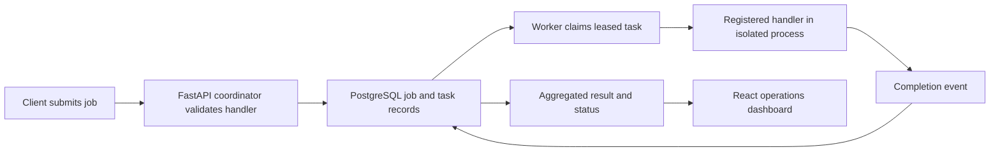

# MeshCompute

MeshCompute is an educational, production-shaped distributed task processor. It accepts jobs through a FastAPI coordinator, stores tasks durably in PostgreSQL, and assigns them to independently running worker processes over HTTP.

## How it works

MeshCompute splits an accepted job into durable tasks. Workers claim tasks through the coordinator; PostgreSQL coordinates claims and tracks leases so abandoned work can be retried.

The API accepts registered handler names rather than executable user code. Lease recovery provides at-least-once attempts, so handler side effects must be idempotent; the system does not promise exactly-once execution.

## Quick start

Requirements: Docker Desktop with its engine running, Docker Compose, and (for local development) Python 3.12+ and Node.js 20+.

1. Copy `.env.example` to `.env`.
2. Start the stack: `docker compose up --build`.
3. Open the dashboard at http://localhost:3000 and API docs at http://localhost:8000/docs.

Compose starts PostgreSQL, applies migrations, starts the coordinator, and launches two workers. Stop with `docker compose down`; add `-v` only when you intend to delete stored database data.

## What happens to a job

`POST /api/v1/jobs` validates a registered handler and splits its input into durable tasks. Workers claim one task at a time; PostgreSQL row locking prevents two workers from claiming the same pending task. Leases, attempt numbers, and a coordinator reaper recover work after a worker disappears. Completion events are persisted and aggregated into a result. The dashboard reads status and receives best-effort live updates over WebSocket.

## Architecture

- `src/meshcompute/domain`: state transitions and framework-independent models.
- `src/meshcompute/coordinator`: HTTP API, orchestration services, persistence, and reaper.
- `src/meshcompute/worker`: HTTP client, heartbeat, process-isolated handler execution.
- `src/meshcompute/common`: shared settings, errors, clock, and logging.
- `dashboard`: read-mostly React operations view, bundled with Vite and served as static assets.
- `migrations`: versioned database schema.
- `tests`: domain, handler, API, and opt-in PostgreSQL recovery coverage.
- `docs`: architecture and design decisions.
- `benchmarks`: repeatable load harness; benchmark output is generated locally, not checked in as a claimed measurement.

Task handlers are explicitly registered, pure functions; the API never accepts executable user code. The sample image handler supports uncompressed 24-bit BMP input without adding native image processing dependencies.

## Development

Use `make install` to create a local virtual environment and install development dependencies, `make check` to run lint, type checks, and tests, and `make migrate` to apply migrations against your configured database. The system model is in `docs/architecture.md`; operating instructions are in `docs/operations.md`.

Configuration is supplied through `MESH_COMPUTE_*` environment variables. The defaults and descriptions live in `src/meshcompute/common/settings.py`.

## Scope and limitations

This is a compact reference system, not a drop-in managed cloud queue. It uses PostgreSQL as its durable queue, keeps WebSocket fanout in coordinator memory, and does not promise exactly-once side effects: handlers must be idempotent because lease recovery can cause retries. Run integration and failure tests with a working Docker engine before relying on a deployment.

