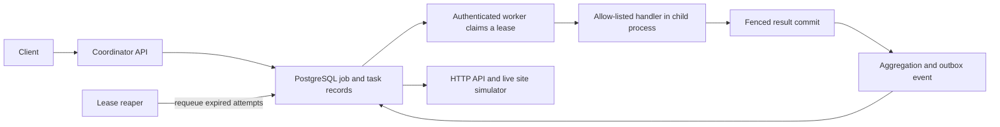

  

  
  

<h1 align="center">MeshCompute</h1>

MeshCompute is a learning project for durable, distributed task processing. A FastAPI coordinator stores allow-listed work in PostgreSQL and leases tasks to worker processes over HTTP.

## How it works

The API never accepts executable user code. Execution is at least once: lease recovery can repeat a handler attempt, and MeshCompute does not promise exactly-once side effects.

## Quick start

Requirements: Docker Desktop with its engine running.

1. Copy `.env.example` to `.env` and replace `MESH_COMPUTE_ADMIN_TOKEN` with a long random value.
2. Start the stack with `docker compose up --build`.
3. Open the coordinator API at http://localhost:8000/docs. The project site is [live on GitHub Pages](https://nihalmachhi.github.io/MeshCompute/).

Compose starts PostgreSQL, applies migrations, starts the coordinator, and launches two workers. Stop it with `docker compose down`; add `-v` only when you intend to delete database data.

## API and safety

`POST /api/v1/jobs` accepts a registered handler name and input reference. Workers claim one task at a time using PostgreSQL row locks. Each lease carries an attempt number used to fence stale results. The coordinator reaper retries expired work. Worker registration requires the admin bearer token and issues a per-worker bearer token; only its hash is stored. Admin job submission, cancellation, and worker listing also require the admin token. In Linux worker containers, handlers run in child processes with configurable CPU, address-space, file-size, wall-time, and output-size limits.

Task results are capped by `MESH_COMPUTE_MAX_RESULT_BYTES` (10 MB by default). Terminal jobs expire after the configured result-retention period (7 days by default), and inactive workers transition through `STALE` to `OFFLINE` before old identities are purged. State-change notifications and PostgreSQL `LISTEN`/`NOTIFY` wakeups are written in the same transaction as the state change. Each coordinator reads the durable outbox with its own cursor and fans events out to its local WebSocket clients; reconnects and missed notifications are recovered by polling the outbox.

## Repository map

- `src/meshcompute/core`: settings, errors, clock, and logging.
- `src/meshcompute/handlers`: allow-listed word-count, image-resize, and CSV handlers plus isolated graph, vision, and NLP utilities.
- `src/meshcompute/coordinator`: API, domain, PostgreSQL repositories, outbox, and background workers.
- `src/meshcompute/worker`: HTTP client, heartbeat loop, and process-isolated handler execution.
- `src/meshcompute/sim`: seeded scheduler simulator and report generator.
- `site`: static project site and browser-based cluster simulator.
- `migrations`: frozen schema revisions.
- `tests`: unit and PostgreSQL integration tests.

## Development

Use `uv sync --frozen --extra dev --all-extras` to install dependencies. Run `uv run ruff check .`, `uv run ruff format --check .`, `uv run mypy src`, `uv run pytest -q --cov=meshcompute --cov-fail-under=80`, and `uv run alembic upgrade head && uv run alembic check`. The site commands are `npm ci`, `npm run lint`, `npm run typecheck`, `npm test -- --run`, and `npm run build` from `site/`.

## Claims -> proof

| Claim | Proof |
|---|---|
| Multi-megabyte handler results return before the worker timeout | `tests/unit/test_executor_large_result.py` |
| Admin and worker tokens fail closed when missing or invalid | `tests/unit/test_auth.py` |
| Committed events are visible through the outbox | `tests/unit/test_outbox.py`, `tests/integration/test_outbox_integration.py` |
| Committed outbox events reach a coordinator's local subscribers after a database notification | `tests/integration/test_outbox_integration.py` |
| CSV chunks use record-aware byte ranges, including quoted newlines | `tests/unit/test_handlers.py` |
| An expired-but-not-reassigned lease can complete; a stale attempt is rejected | `tests/unit/test_lease_grace.py` |
| Oversized results are rejected; expired terminal jobs are purged | `tests/unit/test_result_limit.py`, `tests/integration/test_job_retention.py` |
| Cancellation fences active attempts and clears worker ownership | `tests/integration/test_job_cancel.py` |
| Stale workers transition offline and expire from storage | `tests/integration/test_worker_retention.py` |
| DAG submissions reject cycles; claims wait for prerequisites and terminal failure cancels descendants | `tests/unit/test_dag.py`, `tests/integration/test_dag_dependencies.py` |
| Generated vision/text duplicate reports and image decoding bounds | `tests/unit/test_evaluation.py` |
| Liveness remains up while readiness fails without PostgreSQL | `tests/unit/test_readiness.py` |
| Browser DAG builder prevents cycles and calculates its displayed critical path | `site/src/features/simulator/dag.test.ts` |
| Aged priorities and capability filtering are applied to queued claims | `tests/integration/test_scheduler_policies.py` |
| Chunk-size model selects a lower makespan candidate with overhead and parallelism | `tests/unit/test_evaluation.py` |
| Prometheus formatting reports queue, worker, retries, lease expiry, and runtime buckets | `tests/unit/test_metrics.py` |
| Retry timestamps are deterministic, bounded, and exhausted tasks enter the dead-letter queue | `tests/unit/test_retry.py`, `tests/integration/test_dead_letters.py` |
| Job submissions replay by idempotency key and reject mismatched request bodies | `tests/integration/test_job_idempotency.py` |

## Scope

This is an educational single-coordinator system, not a managed queue. It requires PostgreSQL, uses in-memory WebSocket fanout, and does not implement exactly-once side effects, arbitrary user code, or production-scale benchmarking. The simulator and generated report data are synthetic.

## License

MeshCompute is distributed under the [MIT License](LICENSE).
