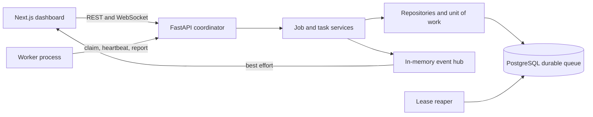
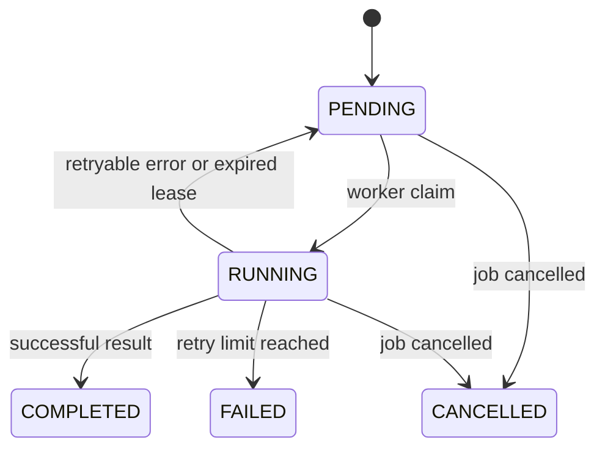

# Architecture and execution flow

The coordinator owns job state, scheduling, retry policy, and persistence. Workers are stateless executors: they poll the API, heartbeat while executing, and report a fenced attempt number. The task repository claims work using PostgreSQL row locks with `SKIP LOCKED`, so multiple coordinators can claim concurrently without a separate broker.

## Task lifecycle

Each claim increments the attempt number and sets an expiring lease. Heartbeats extend the lease. The reaper detects expired attempts and requeues or fails them. A stale attempt cannot commit after a later attempt has been claimed. Delivery is at least once; handlers should be deterministic/idempotent.

The API accepts registered handler names and structured data only. WebSocket events speed up dashboard refresh, while PostgreSQL remains authoritative.
