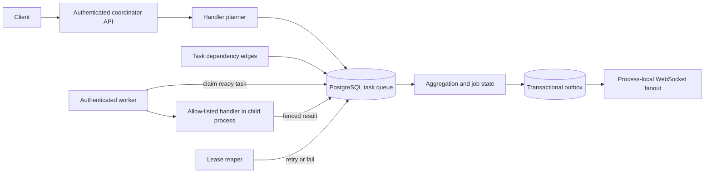

# Architecture

MeshCompute accepts only registered handlers. PostgreSQL stores job/task state, worker
leases, results, dependency edges, audit rows, and the transactional event outbox.

## Task dependencies

Job submission may include `task_dependencies`, an array of `[prerequisite_index,
dependent_index]` pairs referring to the task chunks produced by the registered handler.
The coordinator validates that indices exist and that the edges are acyclic before saving
the job. The worker claim query releases a task only after every prerequisite task is
`COMPLETED`. If a prerequisite exhausts its attempts, pending descendants are cancelled;
the job fails after all active work reaches a terminal state. `GET /api/v1/jobs/{id}/dag`
returns the persisted edges, a topological order, and a unit-cost critical path estimate.

This version gates task order; it does not pass one task's output as another task's input.
The critical-path estimate uses one unit per task rather than observed runtime data.

## Delivery guarantees

Attempts are at least once. A lease reaper can cause a handler to run again; task attempt
numbers fence stale completions. Outbox delivery is also at least once, and live WebSocket
fanout stays in coordinator memory. The outbox is durable, but it is not a cross-replica
WebSocket broadcast mechanism.
